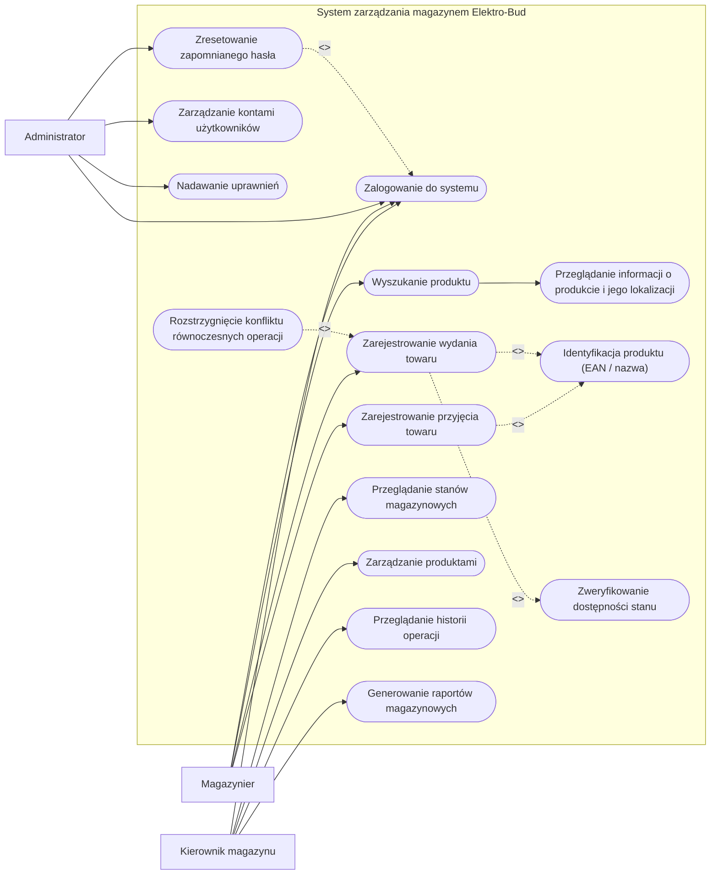

# Projekt Elektro-Bud – analiza wymagań

**Projektowany system:** system zarządzania magazynem hurtowni materiałów elektrycznych i budowlanych „Elektro-Bud".

Analiza opiera się na dwóch źródłach: wstępnym opisie potrzeb klienta oraz rozmowie z klientem (nagranie). Klient obecnie prowadzi magazyn „ręcznie" (dokumenty papierowe, arkusze kalkulacyjne, notatki) i chce zastąpić te rozwiązania jednym dedykowanym systemem. W magazynie pracują trzej magazynierzy.

---

## 1. Wymagania funkcjonalne

| ID | Nazwa | Opis |
|------|-------|------|
| FR-01 | Logowanie użytkownika | System powinien umożliwiać użytkownikowi zalogowanie się przy użyciu własnych, indywidualnych danych dostępowych. Każdy pracownik korzysta z własnego konta – klient nie dopuszcza wspólnego konta, ponieważ uniemożliwiłoby to ustalenie autora operacji. |
| FR-02 | Wyszukiwanie produktu | System powinien umożliwiać wyszukanie produktu po kodzie EAN oraz po nazwie, ponieważ pracownik może znać tylko jeden z tych identyfikatorów. |
| FR-03 | Przeglądanie informacji o produkcie | System powinien prezentować dane produktu (kod EAN, nazwę, kategorię) oraz jego miejsce przechowywania określone przez sektor, regał i półkę, aby pracownik mógł szybko sprawdzić, gdzie produkt się znajduje. |
| FR-04 | Rejestracja przyjęcia towaru | System powinien umożliwiać magazynierowi zarejestrowanie przyjęcia towaru z informacjami o: produkcie, ilości, wykonawcy operacji i czasie jej wykonania. Przyjęcie zwiększa stan magazynowy produktu. |
| FR-05 | Rejestracja wydania towaru | System powinien umożliwiać magazynierowi zarejestrowanie wydania towaru z informacjami o: produkcie, ilości, wykonawcy operacji i czasie jej wykonania. Wydanie zmniejsza stan magazynowy produktu. |
| FR-06 | Kontrola dostępności stanu przy wydaniu | System powinien uniemożliwić zarejestrowanie wydania większej liczby sztuk produktu, niż aktualnie znajduje się na magazynie (stan magazynowy nie może zejść poniżej zera). |
| FR-07 | Obsługa równoczesnych operacji | System powinien poprawnie obsłużyć sytuację, w której dwóch pracowników próbuje wykonać operację (np. wydanie) dotyczącą tego samego produktu w tym samym lub prawie tym samym momencie, tak aby stan magazynowy pozostał poprawny. |
| FR-08 | Przeglądanie stanów magazynowych | System powinien umożliwiać kierownikowi przeglądanie aktualnych stanów magazynowych produktów. |
| FR-09 | Zarządzanie produktami | System powinien umożliwiać kierownikowi dodawanie nowych produktów oraz edycję ich danych: kodu EAN, nazwy, kategorii i miejsca przechowywania (sektor, regał, półka). |
| FR-10 | Przeglądanie historii operacji | System powinien przechowywać historię wszystkich operacji magazynowych i umożliwiać kierownikowi sprawdzenie: kto wykonał operację, jakiego produktu dotyczyła, czego dotyczyła (przyjęcie/wydanie i ilość) oraz kiedy została wykonana. |
| FR-11 | Generowanie raportów | System powinien umożliwiać kierownikowi korzystanie z raportów dotyczących stanu i funkcjonowania magazynu. Dokładny zakres raportów zostanie doprecyzowany w toku dalszej analizy wymagań. |
| FR-12 | Zarządzanie kontami użytkowników | System powinien umożliwiać administratorowi zakładanie, edycję i blokowanie kont użytkowników. |
| FR-13 | Nadawanie uprawnień | System powinien umożliwiać administratorowi nadawanie użytkownikom uprawnień (ról), które określają zakres dostępnych dla nich funkcji. |
| FR-14 | Obsługa zapomnianego hasła | System powinien umożliwiać administratorowi zresetowanie hasła użytkownikowi, który zapomniał danych dostępowych (oraz ewentualnie samodzielny dostęp do konta po zmianie hasła). |

---

## 2. Wymagania niefunkcjonalne

| ID | Nazwa | Opis |
|------|-------|------|
| NFR-01 | Wydajność | System powinien odpowiadać na operację wyszukiwania produktu oraz obsługę kodu EAN w czasie nie dłuższym niż 2 sekundy dla co najmniej 95% żądań w typowych warunkach pracy magazynu. |
| NFR-02 | Bezpieczeństwo haseł | Hasła użytkowników powinny być przechowywane wyłącznie w formie skrótu (np. bcrypt/Argon2 z solą) – uniemożliwiającym zwykły odczyt hasła przez administratora lub osobę z dostępem do bazy danych. |
| NFR-03 | Kontrola dostępu | Zakres dostępnych funkcji powinien zależeć od roli użytkownika (RBAC): magazynier ma dostęp wyłącznie do bieżącej obsługi magazynu, kierownik dodatkowo do stanów, produktów, historii i raportów, a administrator do zarządzania kontami i uprawnieniami. Użytkownik nie powinien mieć dostępu do funkcji zbędnych w jego pracy. |
| NFR-04 | Dostępność | System powinien być dostępny jako aplikacja webowa (przez przeglądarkę) i osiągać dostępność nie mniejszą niż 99,5% czasu pracy hurtowni. Kierownik powinien mieć możliwość korzystania z systemu również poza stanowiskiem w magazynie (dostęp zdalny z dowolnego miejsca z siecią). |
| NFR-05 | Sposób korzystania / ergonomia | Interfejs powinien być prosty i czytelny dla pracowników nietechnicznych: zwykłe, jednoznacznie opisane elementy zamiast „efektownych ozdób". System powinien obsługiwać skaner kodów kreskowych do wprowadzania kodu EAN, a rejestracja typowej operacji (przyjęcie/wydanie) powinna zajmować maksymalnie kilka kroków. |
| NFR-06 | Integralność danych | Stan magazynowy musi pozostać poprawny przy równoczesnych operacjach na tym samym produkcie – system powinien stosować transakcje z blokowaniem (lub optymalistyczną kontrolę współbieżności), tak aby nigdy nie doszło do wydania większej liczby sztuk niż dostępna. |
| NFR-07 | Audytowalność | Każda operacja magazynowa powinna być nieusuwalnie zapisana ze znacznikiem czasu i identyfikatorem wykonawcy; zapisów historii użytkownicy nie mogą modyfikować ani usuwać. |
| NFR-08 | Współbieżność / skala | System powinien poprawnie obsługiwać co najmniej 10 jednocześnie pracujących użytkowników (3 magazynierów, kierownika i zapas na rozwój firmy) bez utraty wydajności. |

---

## 3. Aktorzy

1. **Magazynier** – pracownik magazynu odpowiedzialny za bieżącą obsługę magazynu. W systemie: loguje się na własne konto, wyszukuje produkty (po EAN lub nazwie), sprawdza lokalizację produktów, rejestruje przyjęcia towaru oraz rejestruje wydania towaru.
2. **Kierownik magazynu** – nadzoruje pracę magazynu i potrzebuje szerszego zakresu informacji. W systemie: przegląda stany magazynowe, dodaje i edytuje produkty (wraz z lokalizacją), przegląda historię operacji, generuje raporty; korzysta z systemu również spoza magazynu.
3. **Administrator** – odpowiada za użytkowników systemu. W systemie: zarządza kontami użytkowników, nadaje uprawnienia (role), obsługuje sytuacje zapomnianego hasła (reset hasła).

---

## 4. Diagram przypadków użycia UML

*Granica systemu* została oznaczona obszarem (subgraphem) „System zarządzania magazynem Elektro-Bud", aktorzy znajdują się poza granicą systemu, a przypadki użycia wewnątrz. Strzałki ciągłe łączą aktorów z przypadkami użycia, które realizują; strzałki przerywane z etykietą `<<include>>`/`<<extend>>` to relacje pomiędzy przypadkami użycia.

---

## 5. Relacje `<<include>>` i `<<extend>>` – uzasadnienie (zadanie na ocenę 6)

### Różnica między relacjami

- **`<<include>>`** – przypadek użycia podstawowego **zawsze** wykonuje zawartość przypadku dołączanego. Dołączany przypadek jest wydzielonym, **obowiązkowym** fragmentem zachowania, współdzielonym przez inne przypadki użycia. Relacja jest inicjowana zawsze przez przypadek podstawowy – bez przypadku dołączanego przypadek podstawowy nie może się poprawnie zakończyć.
- **`<<extend>>`** – przypadek rozszerzający jest wykonywany **tylko warunkowo**, w określonym punkcie rozszerzenia (extension point) przypadku podstawowego. Przypadek podstawowy jest w pełni użyteczny bez rozszerzenia i **nie wie o istnieniu** rozszerzenia; to rozszerzenie „dokłada się" do niego dopiero, gdy zajdzie warunek.

Krótko: `<<include>>` = „zawsze, obowiązkowe, z inicjatywy przypadku podstawowego"; `<<extend>>` = „czasem, opcjonalne, z inicjatywy przypadku rozszerzającego".

### Zastosowanie `<<include>>` w modelu

1. **`Zarejestrowanie wydania towaru` → `<<include>>` → `Zweryfikowanie dostępności stanu`.** Klient jednoznacznie zażądał, aby nie dopuścić do wydania większej liczby sztuk, niż znajduje się na magazynie. Weryfikacja stanu jest więc **obowiązkowym krokiem każdego wydania** – nie istnieje poprawnie zakończone wydanie bez sprawdzenia dostępności. Ponadto klient przewiduje równoczesne operacje na tym samym produkcie, więc weryfikacja musi być wydzielonym, zawsze wykonywanym elementem wydania.
2. **`Zarejestrowanie przyjęcia towaru` i `Zarejestrowanie wydania towaru` → `<<include>>` → `Identyfikacja produktu (EAN / nazwa)`.** Zarówno przyjęcie, jak i wydanie wymagają wskazania produktu – pracownik zna czasem tylko kod EAN, czasem tylko nazwę. To wspólny, obowiązkowy fragment obu operacji, więc jego wydzielenie jako `<<include>>` eliminuje powielenie tego samego zachowania w dwóch przypadkach użycia.

### Zastosowanie `<<extend>>` w modelu

1. **`Zresetowanie zapomnianego hasła` → `<<extend>>` → `Zalogowanie do systemu`.** Reset hasła realizowany jest **tylko wtedy, gdy** podczas logowania zajdzie warunkowa sytuacja „użytkownik zapomniał hasła" (extension point). Logowanie samo w sobie jest pełnym, poprawnym przypadkiem użycia i w typowym przebiegu (wysłanie poprawnych danych) nic się do niego nie dokłada – rozszerzenie wykonuje się wyłącznie w sytuacji wyjątkowej.
2. **`Rozstrzygnięcie konfliktu równoczesnych operacji` → `<<extend>>` → `Zarejestrowanie wydania towaru`.** Konflikt (dwóch magazynierów próbuje jednocześnie wydać tę samą sztukę towaru) **nie występuje w każdym wydaniu** – jest to sytuacja wyjątkowa, wprost wymieniona przez klienta w rozmowie. Rozszerzenie uruchamia się dopiero w punkcie rozszerzenia „wykryto równoczesną operację na tym samym produkcie" i w typowym przebiegu wydania w ogóle nie ma miejsca, dlatego jest to `<<extend>>`, a nie `<<include>>`.

---

## Uwagi do dalszej analizy

- Zakres raportów (FR-11) nie został przez klienta ustalony – do doprecyzowania na kolejnych spotkaniach.
- Klient dopuszcza modyfikację schematu oznaczeń lokalizacji (sektor/regał/półka) – system powinien przechowywać lokalizację jako dane, a nie sztywną regułę.
- Klient sygnalizował opcję logowania kartą RFID jako możliwe rozszerzenie w przyszłości – na tym etapie nie jest wymaganiem.
- W pierwszej wersji klient oczekuje prostego, poglądowego rozwiązania obejmującego produkty, stany, przyjęcia i wydania.
